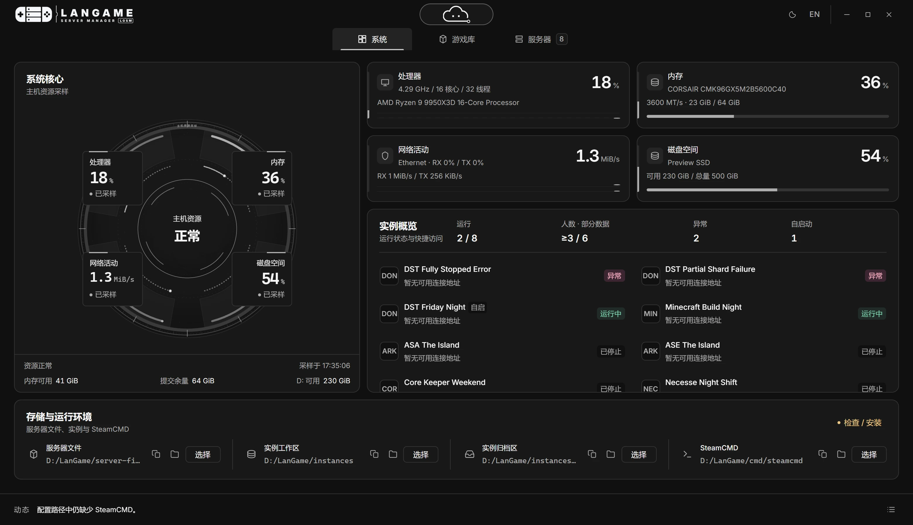

  <a href="https://langame.cn/products/langame-server-manager/"><picture><source media="(prefers-color-scheme: dark)" srcset="assets/logo-dark.svg"></picture></a>

# LanGame Server Manager

[简体中文](README.md) | [English](README.en.md)

[Website](https://langame.cn/) · [Product page](https://langame.cn/products/langame-server-manager/) · [Documentation](docs/README.md#english) · [Hosting guides](https://langame.cn/hosting/)

LanGame Server Manager is a Windows desktop app for installing, configuring, and running dedicated game servers, turning a spare laptop, an old PC, or a Windows Server machine into a game host.

  

## Features

- One-click server installation with managed SteamCMD and required runtimes
- Native per-game settings with isolated instances
- Mod installation, updates, and management
- Built-in LanGameCMD hosts your servers, with no annoying CMD pop-ups
- Resource and instance status monitoring
- Player management, plus GM tools for supported games
- Save import, backup, and recovery
- Optional LAN AI assistant (bring your own model service)

Supports [32 games](docs/games.md#english).

## Download and get started

Download the Windows installer from [GitHub Releases](https://github.com/SZSLGJCOM/LanGame-Server-Manager/releases), install it, and add a server in the app. Runs on Windows 10 / 11 and Windows Server.

Players on the same LAN can join directly, or you can pair it with networking tools such as Radmin VPN or Hamachi. For public hosting, the app configures Windows Firewall rules automatically; router port forwarding is up to you. See the [networking guide](https://langame.cn/networking/).

## Development

[Build from source](docs/development.md#english) · [Privacy](PRIVACY.md#english)

## License

Source-available, noncommercial use only: [License](LICENSE) · [Brand rules](NOTICE) · [Contributing](CONTRIBUTING.md#english) · [Security](SECURITY.md#english)

## LanGame products

- [LanGame OS Orbit](https://langame.cn/products/langame-os-orbit/): an AI game terminal for PC players; players on the same network can discover and join supported servers from Orbit
- [LanGame OS Stellar](https://langame.cn/products/langame-os-stellar/): an AI venue management platform for esports spaces
- [LanGame OS Lunet](https://langame.cn/products/langame-os-lunet/): the SOFA streaming core on Android, for streaming from Orbit on the same network

## Community

[Issues](https://github.com/SZSLGJCOM/LanGame-Server-Manager/issues) · [WeChat Official Account](assets/wechat-official-account.jpg)
