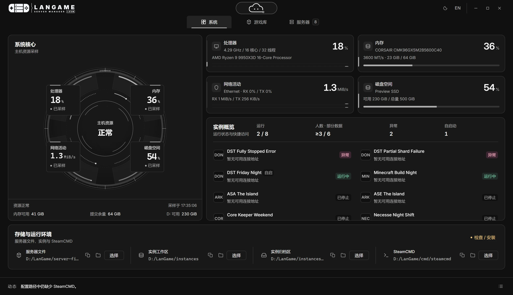

  <a href="https://langame.cn/products/langame-server-manager/"><picture><source media="(prefers-color-scheme: dark)" srcset="assets/logo-dark.svg"></picture></a>

# LanGame Server Manager

[简体中文](README.md) | [English](README.en.md)

[官网](https://langame.cn/) · [产品页](https://langame.cn/products/langame-server-manager/) · [使用文档](docs/README.md#简体中文) · [开服教程](https://langame.cn/hosting/)

LanGame Server Manager 是一款 Windows 桌面应用，用来安装、配置和运维游戏专用服务器，闲置的旧笔记本、旧电脑或 Windows Server 都能当服务器。

> ⭐ 如果 LanGame Server Manager 让你开服更省心，欢迎点个 Star 支持一下，给我们继续打磨的动力！

  

## 功能

- 一键安装专服，自动准备 SteamCMD 和所需运行库
- 按游戏编辑原生配置，多实例互相隔离
- Mod 安装、更新与管理
- 内置 LanGameCMD 托管服务器，告别烦人的 CMD 黑框弹窗
- 资源与实例状态监控
- 玩家管理，以及部分游戏支持的 GM 工具
- 存档导入与备份恢复
- 可选的 LAN AI 助手（使用自己的模型服务）

支持 [32 款游戏](docs/games.md#简体中文)。

## 下载与开始

从 [GitHub Releases](https://github.com/SZSLGJCOM/LanGame-Server-Manager/releases) 下载 Windows 安装包，安装后在应用中添加服务器即可。支持 Windows 10 / 11 和 Windows Server。

同一局域网可直接联机，也可搭配 Radmin VPN、Hamachi 等组网工具；公网联机时应用会自动配置 Windows 防火墙规则，路由器端口映射需自行设置，详见[联机教程](https://langame.cn/networking/)。

## 开发

[从源码构建](docs/development.md#简体中文) · [贡献指南](CONTRIBUTING.md#简体中文) · [隐私说明](PRIVACY.md#简体中文)

## 许可

源码可见，非商业使用免费。欢迎个人和玩家社群开服、学习源码及私下修改。

未经书面授权，不得商用（包括业务引流）、二次打包、独立发布修改版，或把本项目冒充为自有产品。详见[许可协议](LICENSE)。

## LanGame 产品

- [LanGame OS Orbit](https://langame.cn/products/langame-os-orbit/)：面向 PC 玩家的 AI 游戏终端，同网玩家可在 Orbit 中发现并加入受支持的服务
- [LanGame OS Stellar](https://langame.cn/products/langame-os-stellar/)：面向电竞空间与专业场馆的 AI 管理平台
- [LanGame OS Lunet](https://langame.cn/products/langame-os-lunet/)：手机也能玩电脑游戏，让 Android 成为你的随身游戏掌机。支持串流，并持续开发本地模拟器与 PC 游戏本地运行体验

## 社区

欢迎注明出处的介绍、教程、评测和分享，推荐直接链接[官方仓库](https://github.com/SZSLGJCOM/LanGame-Server-Manager)或[官方下载页](https://github.com/SZSLGJCOM/LanGame-Server-Manager/releases)。

[Issues](https://github.com/SZSLGJCOM/LanGame-Server-Manager/issues) · [报告安全问题](SECURITY.md#简体中文) · [微信公众号](assets/wechat-official-account.jpg)
